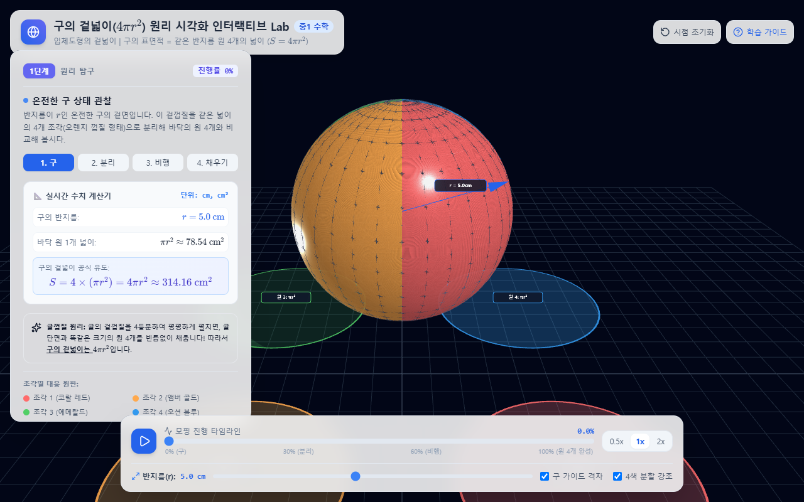
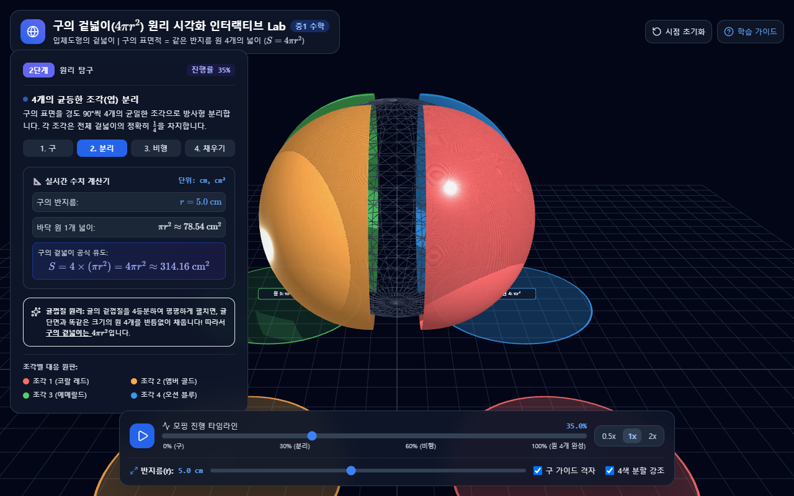
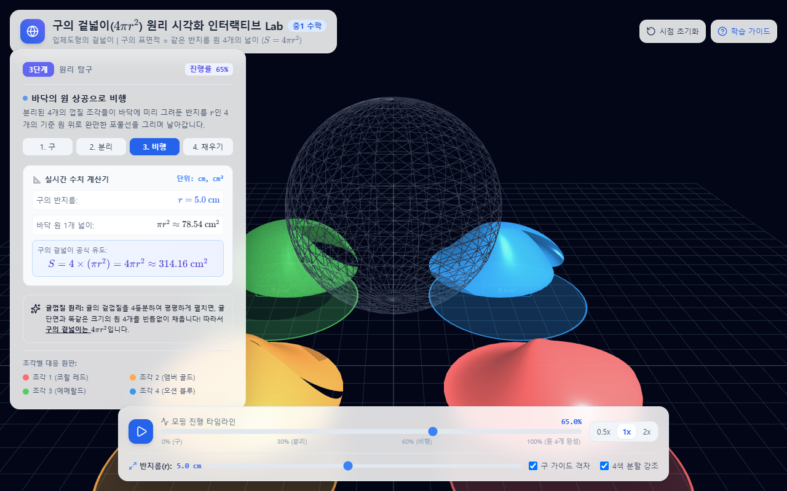
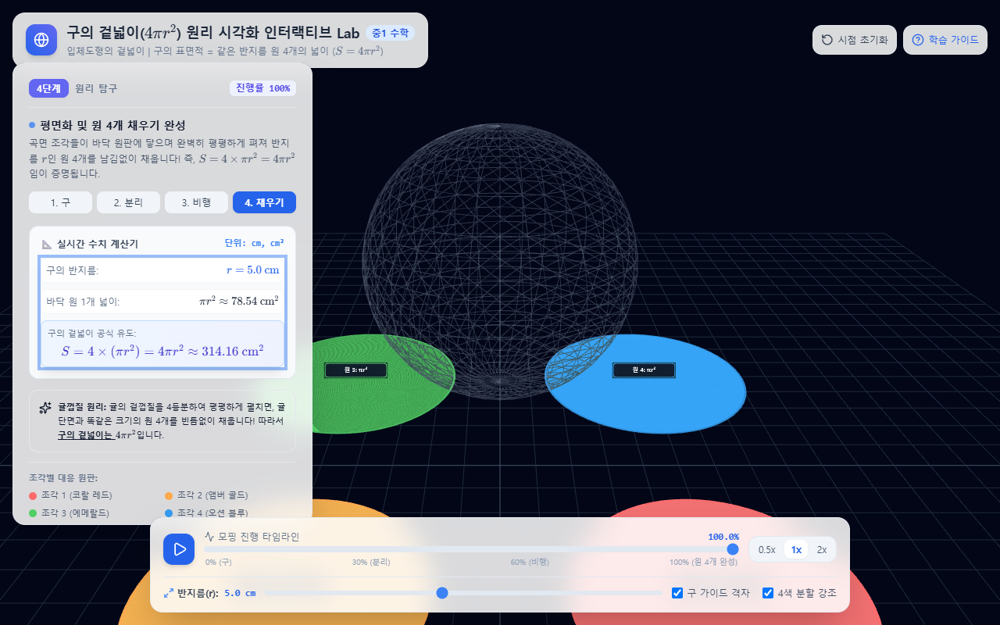

# 🌐 구의 겉넓이($4\pi r^2$) 원리 시각화 인터랙티브 Lab

> **"구의 껍질을 4조각으로 나누면, 반지름이 같은 원 4개를 빈틈없이 채울 수 있을까?"**  
> 구의 겉넓이 공식 $S = 4\pi r^2$의 기하학적 원리를 3D 인터랙티브 귤껍질 분해 및 원 채우기 모핑 애니메이션으로 직관적으로 탐구하는 웹 기반 수학교구입니다.

[](https://WBmaker2.github.io/sphere-surface-lab/)
[](LICENSE)
[](tests/)

---

## 🚀 라이브 체험 링크 (GitHub Pages)

인터넷 브라우저에서 바로 조작해 보실 수 있습니다:  
👉 **[https://WBmaker2.github.io/sphere-surface-lab/](https://WBmaker2.github.io/sphere-surface-lab/)**

---

## 📸 4단계 수학적 모핑 과정

| 1단계: 온전한 구 상태 관찰 | 2단계: 4개의 균등한 조각 분리 |
| :---: | :---: |
|  |  |
| 반지름 $r$인 구와 3D 반지름 화살표 관찰 | 경도 $90^\circ$씩 4개의 균일한 구면 엽(Gore)으로 방사형 분리 |
| **3단계: 바닥 4개 원 상공으로 비행** | **4단계: 평면화 및 원 4개 채우기 완성** |
|  |  |
| 바닥에 놓인 반지름 $r$인 원 4개 위로 포물선 비행 | 곡면이 평평하게 펴지며 4개의 원판을 가득 채움 ($S = 4\pi r^2$) |

---

## 💡 수학적 원리 (Mathematical Intuition)

구의 겉넓이 공식 $S = 4\pi r^2$은 반지름이 $r$인 **평면 원($\pi r^2$) 4개의 넓이의 합**과 정확히 같습니다.

$$S = \pi r^2 + \pi r^2 + \pi r^2 + \pi r^2 = 4\pi r^2$$

- **구면 4분할 (Quadrant Gores)**: 구의 경도(Longitude)를 $90^\circ$씩 4등분한 각 조각의 겉넓이는 전체 겉넓이의 $\frac{1}{4}$입니다.
- **바닥 기준 원판 4개**: 바닥 평면($y = -1.8r$)에 대칭 배치된 4개의 원은 구와 동일한 반지름 $r$을 가지며, 각각 넓이가 $\pi r^2$입니다.
- **곡면의 평면화 (Flattening Morphing)**: 3차 스무스스텝(Smoothstep) 보간을 통해 구면 조각이 평면 원으로 변형되며, 넓이의 손실이나 틈새 없이 4개의 원을 정확히 1:1로 덮는 것을 눈으로 확인할 수 있습니다.

---

## ✨ 핵심 기능

1. **무설치 단일 독립 파일 (Zero-Setup)**:
   - 외부 빌드 도구 없이 `index.html` 단일 파일만으로 실행 가능.
2. **실시간 KaTeX 수식 연동**:
   - 반지름($r$) 슬라이더 조작 시 3D 모델, 바닥 원판, 그리고 수식($r$, $\pi r^2$, $S = 4\pi r^2$)이 실시간 동기화.
3. **직관적인 3D 인터랙션 (Three.js & OrbitControls)**:
   - 마우스 좌클릭 드래그: 360° 자유 궤도 회전
   - 마우스 휠: 확대/축소
   - 마우스 우클릭 드래그: 화면 이동
   - 시점 초기화 버튼 및 단축키(`R`) 지원
4. **Web Audio API 청각적 피드백**:
   - 100% 원 채우기 완료 시 맑은 4음 아르페지오 차임벨(C5-E5-G5-C6)과 바닥 원판 발광 펄스 연출.
   - 스텝 전환 클릭 사운드(`playTick`).
5. **학습자 배려 UX & 접근성**:
   - 단축키 지원: `Space` (재생/일시정지), `R` (시점 리셋), `Escape` (도움말 닫기).
   - WAI-ARIA 접근성 라벨 및 고대비 다크 테마 디자인(WCAG 준수).
   - 대한민국 2022 개정 중학교 1학년 수학교육과정 공인 한국어 용어 준수.

---

## 💻 로컬 실행 방법

별도의 설치 과정 없이 웹 브라우저로 바로 열 수 있습니다:

```bash
# 저장소 복제
git clone https://github.com/WBmaker2/sphere-surface-lab.git
cd sphere-surface-lab

# 브라우저에서 index.html 파일 열기 (Windows)
start index.html

# 또는 Mac / Linux
open index.html   # Mac
xdg-open index.html # Linux
```

---

## 🧪 테스트 실행

Node.js 내장 테스트 러너와 Playwright를 통한 E2E 검증이 포함되어 있습니다:

```bash
# 의존성 설치 (E2E 테스트용)
npm install

# 수학 코어 및 UI 상태 단위 테스트 (21개 테스트)
npm test

# 브라우저 실구동 E2E 테스트 (Playwright)
npm run test:e2e
```

---

## 📚 교육과정 연계 안내
- **대상**: 중학교 1학년
- **단원**: 기본도형과 입체도형 > 입체도형의 겉넓이와 부피
- **성취기준**: [9수03-12] 기둥, 뿔, 구의 겉넓이와 부피를 구할 수 있다.

---

## 📄 라이선스
This project is licensed under the MIT License - see the [LICENSE](LICENSE) file for details.
