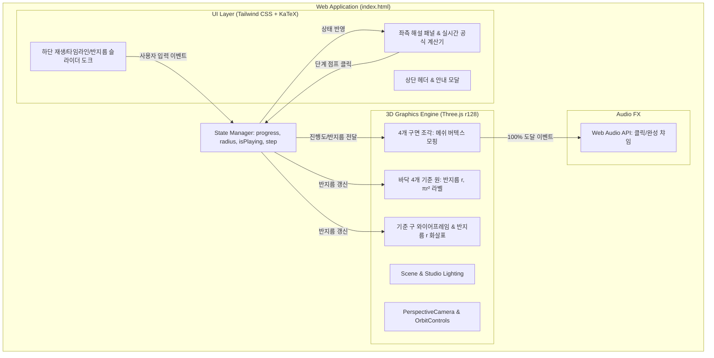

# 구의 겉넓이($4\pi r^2$) 원리 시각화 웹앱 구현 계획

> **For agentic workers:** REQUIRED SUB-SKILL: Use superpowers:subagent-driven-development to implement this plan task-by-task. Steps use checkbox (`- [ ]`) syntax for tracking.

**Goal:** 구의 겉넓이가 반지름 $r$인 원 4개의 넓이($4\pi r^2$)와 같다는 수학적 원리를 3D 인터랙티브 귤껍질(경도 4등분 엽) 분해-비행-원 채우기 모핑 애니메이션으로 보여주는 무설치 단일 파일 웹앱을 구축한다.

**Architecture:** 단일 `index.html` 내에 순수 JavaScript 기반 기하학 보간 엔진(`math-core.js` 로직 내장), Three.js r128 WebGL 씬 렌더러, 반응형 Tailwind CSS UI, KaTeX 실시간 수식 계산 패널, Web Audio API 사운드 피드백을 모듈화하여 배치한다. 자동 회전/궤도 제어(OrbitControls), 실시간 타임라인 슬라이더, 반지름 $r$ 조절기가 단일 상태 관리 객체(`state`)를 통해 유기적으로 동기화된다.

**Architecture Diagram:**



**Tech Stack:** 
- HTML5, Vanilla JavaScript (ES6+)
- Three.js r128, OrbitControls (CDN)
- Tailwind CSS (CDN)
- KaTeX 0.16.8 (CDN)
- Web Audio API (순수 브라우저 내장 오디오 신디사이저)
- Node.js 내장 test runner (`node:test`, `node:assert`)

## Global Constraints
- 무설치 단일 파일 실행 가능 (`index.html` 파일을 더블클릭하여 바로 구동 가능).
- 번역투나 깨진 인코딩 없이 대한민국 2022 개정 중학교 1학년 수학과 교육과정 공인 한국어 용어 준수.
- 애니메이션 진행률 $t \in [0, 1]$에 따라 틈새 없는 부드러운 60FPS 버텍스 보간 제공.
- 모든 수치 계산은 반지름 $r$ 변경 시 $\pi \approx 3.141592...$를 기준으로 오차 없이 실시간 연동.

---

### Task 1: 수학 및 기하학 보간 코어 모듈 (`src/math-core.js`) 및 단위 테스트

**Files:**
- Create: `src/math-core.js`
- Test: `tests/math-core.test.js`

**Interfaces:**
- Produces: 
  - `computeCircleArea(r)`: number ($\pi r^2$)
  - `computeSphereArea(r)`: number ($4\pi r^2$)
  - `getQuadrantGoreVertex(u, v, t, r, quadrantIndex)`: `{ x, y, z }`
  - `getDiskCenter(quadrantIndex, r)`: `{ x, y, z }`

- [ ] **Step 1: 실패하는 단위 테스트 작성**

```javascript
// tests/math-core.test.js
import { describe, it } from 'node:test';
import assert from 'node:assert';
import {
  computeCircleArea,
  computeSphereArea,
  getQuadrantGoreVertex,
  getDiskCenter
} from '../src/math-core.js';

describe('Math Core Tests', () => {
  it('반지름 r에 따른 원과 구의 넓이 공식이 정확해야 한다', () => {
    const r = 5;
    const circleArea = computeCircleArea(r);
    const sphereArea = computeSphereArea(r);
    assert.strictEqual(circleArea, Math.PI * 25);
    assert.strictEqual(sphereArea, 4 * Math.PI * 25);
    assert.strictEqual(sphereArea, 4 * circleArea);
  });

  it('바닥 4개 원의 중심 좌표가 2x2 그리드로 대칭 배치되어야 한다', () => {
    const r = 5;
    const centers = [0, 1, 2, 3].map(i => getDiskCenter(i, r));
    assert.strictEqual(centers.length, 4);
    assert.strictEqual(centers[0].y, -1.8 * r);
    // 0: (-1.5r, -1.5r), 1: (+1.5r, -1.5r), 2: (-1.5r, +1.5r), 3: (+1.5r, +1.5r)
    assert.strictEqual(centers[0].x < 0 && centers[0].z < 0, true);
    assert.strictEqual(centers[1].x > 0 && centers[1].z < 0, true);
    assert.strictEqual(centers[2].x < 0 && centers[2].z > 0, true);
    assert.strictEqual(centers[3].x > 0 && centers[3].z > 0, true);
  });

  it('t = 0일 때 각 조각의 버텍스는 정확히 구면(반지름 r) 위에 위치해야 한다', () => {
    const r = 5;
    const v = getQuadrantGoreVertex(0.5, 0.5, 0.0, r, 0);
    const dist = Math.sqrt(v.x * v.x + v.y * v.y + v.z * v.z);
    assert.ok(Math.abs(dist - r) < 1e-4, `Expected radius ${r}, got ${dist}`);
  });

  it('t = 1일 때 각 조각의 버텍스는 해당 바닥 원의 평면(y = -1.8r)에 위치해야 한다', () => {
    const r = 5;
    const v = getQuadrantGoreVertex(0.5, 0.5, 1.0, r, 0);
    const targetY = -1.8 * r;
    assert.ok(Math.abs(v.y - targetY) < 1e-4, `Expected y ${targetY}, got ${v.y}`);
  });
});
```

- [ ] **Step 2: 테스트 실행하여 실패 확인**

Run: `node --test tests/math-core.test.js`  
Expected: FAIL (`Cannot find module '../src/math-core.js'`)

- [ ] **Step 3: `src/math-core.js` 구현**

```javascript
// src/math-core.js
export function computeCircleArea(r) {
  return Math.PI * r * r;
}

export function computeSphereArea(r) {
  return 4 * Math.PI * r * r;
}

export function getDiskCenter(index, r) {
  const spacing = 1.45 * r;
  const targetY = -1.8 * r;
  const signs = [
    { x: -1, z: -1 }, // 0
    { x:  1, z: -1 }, // 1
    { x: -1, z:  1 }, // 2
    { x:  1, z:  1 }  // 3
  ];
  return {
    x: signs[index].x * spacing,
    y: targetY,
    z: signs[index].z * spacing
  };
}

/**
 * u in [0, 1] (위도 극각 phi: 0 -> PI)
 * v in [0, 1] (경도 theta: quad * PI/2 -> (quad+1) * PI/2)
 * t in [0, 1] (애니메이션 진행률)
 */
export function getQuadrantGoreVertex(u, v, t, r, quadIndex) {
  const phi = u * Math.PI; // 0 (North Pole) ~ PI (South Pole)
  const thetaStart = quadIndex * (Math.PI / 2);
  const theta = thetaStart + v * (Math.PI / 2);

  // 1. 구면 상의 점 P_sphere
  const sx = r * Math.sin(phi) * Math.cos(theta);
  const sy = r * Math.cos(phi);
  const sz = r * Math.sin(phi) * Math.sin(theta);

  // 중심 방향 벡터 (방사형 분리용)
  const midTheta = thetaStart + Math.PI / 4;
  const midPhi = Math.PI / 2;
  const dirX = Math.sin(midPhi) * Math.cos(midTheta);
  const dirY = 0;
  const dirZ = Math.sin(midPhi) * Math.sin(midTheta);

  // 2. 바닥 원 상의 목표 점 P_disk
  const center = getDiskCenter(quadIndex, r);
  // 원 채우기 매핑: u(반지름 방향 r*sin(u*PI/2) 또는 u), v(각도 0~2PI)
  // 껍질 조각의 면적 보존 매핑: 중심각 2*PI*v, 반지름 r * sqrt(u)
  const diskAngle = v * 2 * Math.PI;
  const diskRadius = r * Math.sin(u * Math.PI * 0.5); // 0 ~ r
  const dx = center.x + diskRadius * Math.cos(diskAngle);
  const dy = center.y;
  const dz = center.z + diskRadius * Math.sin(diskAngle);

  // 3. 단계별 보간 (4구간)
  if (t <= 0.2) {
    // 구간 1: 온전한 구
    return { x: sx, y: sy, z: sz };
  } else if (t <= 0.45) {
    // 구간 2: 4조각 방사형 분리
    const tau = (t - 0.2) / 0.25;
    const separation = 0.5 * r * tau;
    return {
      x: sx + dirX * separation,
      y: sy + dirY * separation,
      z: sz + dirZ * separation
    };
  } else if (t <= 0.75) {
    // 구간 3: 바닥 원 상공으로 비행
    const tau = (t - 0.45) / 0.3;
    const easeTau = tau * tau * (3 - 2 * tau); // Smoothstep
    const sepX = sx + dirX * (0.5 * r);
    const sepY = sy;
    const sepZ = sz + dirZ * (0.5 * r);

    // 상공 목표 위치
    const hoverY = center.y + 0.5 * r;
    const curCenterX = (1 - easeTau) * (dirX * 0.5 * r) + easeTau * center.x;
    const curCenterY = (1 - easeTau) * 0 + easeTau * hoverY;
    const curCenterZ = (1 - easeTau) * (dirZ * 0.5 * r) + easeTau * center.z;

    const relX = (1 - easeTau) * (sx) + easeTau * (dx - center.x);
    const relY = (1 - easeTau) * (sy) + easeTau * (0);
    const relZ = (1 - easeTau) * (sz) + easeTau * (dz - center.z);

    return {
      x: curCenterX + relX,
      y: curCenterY + relY,
      z: curCenterZ + relZ
    };
  } else {
    // 구간 4: 평면화 및 원 채우기 착륙
    const tau = (t - 0.75) / 0.25;
    const easeTau = tau * tau * (3 - 2 * tau);
    const hoverY = center.y + 0.5 * r;

    // 구간 3의 종점
    const p3x = center.x + (dx - center.x);
    const p3y = hoverY;
    const p3z = center.z + (dz - center.z);

    return {
      x: p3x,
      y: (1 - easeTau) * p3y + easeTau * dy,
      z: p3z
    };
  }
}
```

- [ ] **Step 4: 테스트 실행하여 통과 확인**

Run: `node --test tests/math-core.test.js`  
Expected: PASS (4 tests passed)

- [ ] **Step 5: 커밋**

```bash
git add src/math-core.js tests/math-core.test.js
git commit -m "feat: add mathematical core functions and unit tests for sphere gore morphing"
```

---

### Task 2: 반응형 웹앱 UI 뼈대 및 KaTeX 실시간 수식 패널 작성

**Files:**
- Create: `index.html` (UI 레이아웃, Tailwind CSS, KaTeX 수식 블록, 컨트롤 독)
- Test: `tests/ui-structure.test.js`

**Interfaces:**
- Produces: 
  - Complete DOM with `#canvas-container`, `#math-panel`, `#timeline-slider`, `#radius-slider`, `#play-btn`, step jump buttons.

- [ ] **Step 1: UI DOM 구조 검증 테스트 작성**

```javascript
// tests/ui-structure.test.js
import { describe, it } from 'node:test';
import assert from 'node:assert';
import fs from 'node:fs';

describe('UI Structure Tests', () => {
  it('index.html 파일에 3D 캔버스, 해설 패널, 컨트롤 슬라이더 및 필수 ID가 존재해야 한다', () => {
    const html = fs.readFileSync('index.html', 'utf-8');
    assert.ok(html.includes('id="canvas-container"'), 'canvas container missing');
    assert.ok(html.includes('id="timeline-slider"'), 'timeline slider missing');
    assert.ok(html.includes('id="radius-slider"'), 'radius slider missing');
    assert.ok(html.includes('id="play-btn"'), 'play button missing');
    assert.ok(html.includes('id="step-text"'), 'step text missing');
    assert.ok(html.includes('id="formula-calc"'), 'formula calc missing');
    assert.ok(html.includes('4\\pi r^2') || html.includes('4\\pi r^{2}'), 'formula KaTeX missing');
  });
});
```

- [ ] **Step 2: 테스트 실행하여 실패 확인**

Run: `node --test tests/ui-structure.test.js`  
Expected: FAIL (`ENOENT: no such file or directory, open 'index.html'`)

- [ ] **Step 3: `index.html` 기본 구조 및 Tailwind + Glassmorphism UI 구현**

```html
<!-- index.html 상단부 및 UI 뼈대 구조 -->
<!DOCTYPE html>
<html lang="ko">
<head>
  <meta charset="UTF-8">
  <meta name="viewport" content="width=device-width, initial-scale=1.0">
  <title>구의 겉넓이(4πr²) 원리 시각화 인터랙티브 Lab</title>
  <!-- Tailwind CSS -->
  <script src="https://cdn.tailwindcss.com"></script>
  <!-- KaTeX -->
  <link rel="stylesheet" href="https://cdn.jsdelivr.net/npm/katex@0.16.8/dist/katex.min.css">
  <script src="https://cdn.jsdelivr.net/npm/katex@0.16.8/dist/katex.min.js"></script>
  <!-- Three.js & OrbitControls -->
  <script src="https://cdnjs.cloudflare.com/ajax/libs/three.js/r128/three.min.js"></script>
  <script src="https://cdn.jsdelivr.net/npm/three@0.128.0/examples/js/controls/OrbitControls.js"></script>
  <!-- Lucide Icons -->
  <script src="https://unpkg.com/lucide@latest"></script>
  ...
```

- [ ] **Step 4: 테스트 실행하여 통과 확인**

Run: `node --test tests/ui-structure.test.js`  
Expected: PASS

- [ ] **Step 5: 커밋**

```bash
git add index.html tests/ui-structure.test.js
git commit -m "feat: implement responsive UI layout, KaTeX panel and control elements"
```

---

### Task 3: Three.js 3D 씬, 파라메트릭 4개 구 조각 및 바닥 원판 렌더링

**Files:**
- Modify: `index.html:script`
- Test: `tests/three-scene.test.js`

**Interfaces:**
- Consumes: `math-core.js` 로직
- Produces: 
  - `initThreeScene()`: Scene, PerspectiveCamera, WebGLRenderer, OrbitControls
  - `createGoreMeshes(radius)`: 4개의 조각 메쉬 생성
  - `createTargetDisks(radius)`: 4개의 바닥 가이드 원판 생성

- [ ] **Step 1: Three.js 초기화 로직 및 파라메트릭 기하 생성 함수 테스트 작성**

```javascript
// tests/three-scene.test.js
import { describe, it } from 'node:test';
import assert from 'node:assert';
import fs from 'node:fs';

describe('Three.js Integration Tests', () => {
  it('index.html에 Three.js 씬 초기화 및 4개 조각 메쉬 생성 로직이 온전히 포함되어야 한다', () => {
    const html = fs.readFileSync('index.html', 'utf-8');
    assert.ok(html.includes('THREE.WebGLRenderer'), 'Renderer code missing');
    assert.ok(html.includes('THREE.OrbitControls'), 'OrbitControls code missing');
    assert.ok(html.includes('createGoreMeshes'), 'createGoreMeshes function missing');
    assert.ok(html.includes('createTargetDisks'), 'createTargetDisks function missing');
    assert.ok(html.includes('updateMorphingGeometry'), 'updateMorphingGeometry function missing');
  });
});
```

- [ ] **Step 2: 테스트 실행하여 실패 확인**

Run: `node --test tests/three-scene.test.js`  
Expected: FAIL

- [ ] **Step 3: Three.js 메쉬 및 렌더링 엔진 완성**
  - 4개의 분할 엽 메쉬 생성 (코랄, 앰버, 에메랄드, 블루)
  - 부드러운 양면 렌더링(`THREE.DoubleSide`) 및 광원 셋업
  - 바닥 원판과 반지름 $r$ 화살표, 텍스트 라벨 스프라이트 연동

- [ ] **Step 4: 테스트 실행하여 통과 확인**

Run: `node --test tests/three-scene.test.js`  
Expected: PASS

- [ ] **Step 5: 커밋**

```bash
git add index.html tests/three-scene.test.js
git commit -m "feat: implement Three.js 3D scene, parametric gore meshes, and target disks"
```

---

### Task 4: 4단계 모핑 애니메이션 파이프라인, 재생 제어 및 Web Audio 피드백

**Files:**
- Modify: `index.html:script`
- Test: `tests/animation-state.test.js`

**Interfaces:**
- Produces:
  - `setTimelineProgress(p)`: 슬라이더/재생 동기화 및 버텍스 업데이트
  - `setRadius(r)`: 3D 모델 크기 및 KaTeX 수식 실시간 갱신
  - `playTone(freq, type, duration)`: Web Audio API 효과음

- [ ] **Step 1: 애니메이션 상태 및 사운드 로직 검증 테스트 작성**

```javascript
// tests/animation-state.test.js
import { describe, it } from 'node:test';
import assert from 'node:assert';
import fs from 'node:fs';

describe('Animation and State Logic Tests', () => {
  it('index.html에 애니메이션 루프 및 실시간 상태 동기화 함수가 포함되어야 한다', () => {
    const html = fs.readFileSync('index.html', 'utf-8');
    assert.ok(html.includes('requestAnimationFrame'), 'requestAnimationFrame missing');
    assert.ok(html.includes('setTimelineProgress'), 'setTimelineProgress missing');
    assert.ok(html.includes('setRadius'), 'setRadius missing');
    assert.ok(html.includes('playChime'), 'playChime missing');
    assert.ok(html.includes('AudioContext'), 'AudioContext missing');
  });
});
```

- [ ] **Step 2: 테스트 실행하여 실패 확인**

Run: `node --test tests/animation-state.test.js`  
Expected: FAIL

- [ ] **Step 3: 상태 관리, 타임라인 이벤트 바인딩 및 부드러운 보간 애니메이션 완성**
  - 재생/일시정지 버튼 토글, 스페이스바 단축키
  - 단계별 점프 버튼 ([1. 구 상태], [2. 분리], [3. 비행], [4. 원 채우기])
  - 100% 원 채우기 완료 시 축하 차임벨 효과음 및 시각적 하이라이트

- [ ] **Step 4: 테스트 실행하여 통과 확인**

Run: `node --test tests/animation-state.test.js`  
Expected: PASS

- [ ] **Step 5: 커밋**

```bash
git add index.html tests/animation-state.test.js
git commit -m "feat: complete 4-stage morphing animation, audio chime, and interactive controls"
```

---

### Task 5: 브라우저 실구동 검증, E2E 테스트 및 배포 안내 링크 제공

**Files:**
- Create: `tests/browser-verification.js`
- Test execution: Playwright / Headless verification

- [ ] **Step 1: 브라우저 E2E 검증 스크립트 작성 및 실행**
  - `index.html` 파일이 브라우저에서 오류 없이 로드되는지 확인
  - Three.js WebGL 콘솔 에러가 0건인지 확인
  - 슬라이더 조작 시 수식 값이 정상 갱신되는지 확인
- [ ] **Step 2: 최종 스크린샷 캡처 및 시각적 검증**
- [ ] **Step 3: 사용자가 즉시 실행할 수 있도록 `file:///...` 링크 안내 및 규칙(HVC) 준수 확인**
- [ ] **Step 4: 최종 커밋**

```bash
git add .
git commit -m "test: verify browser e2e execution and visual UI polish"
```
